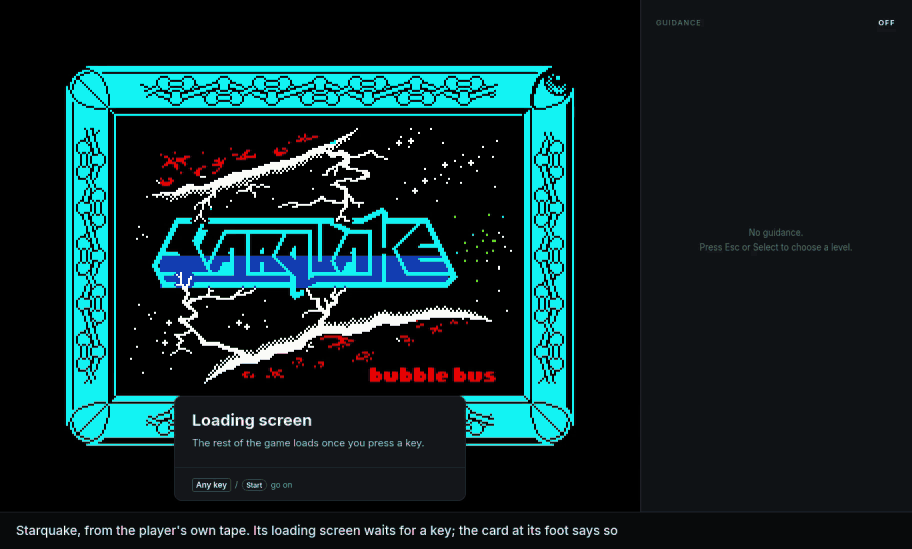

# ZX Sidekick

Play original ZX Spectrum games from your own copy, with a gamepad, optional training switches, a guidance panel, save games and kept high scores. The original program runs, unchanged, in an emulated Spectrum. What ZX Sidekick adds for each game comes from a **definition**, a TOML or JSON file anyone can write, in [`games/`](games/).

Early days: the plan is [`ZX-SIDEKICK.md`](ZX-SIDEKICK.md), the definition format is [`docs/definition-format.md`](docs/definition-format.md), and the reference game is [Starquake](docs/games/starquake.md).

[](docs/media/showcase.mp4)

Forty seconds of ZX Sidekick running Starquake from the player's own tape: the cards on the loading screen and the title, How to play with its clips running, play with the cursor keys, the guidance menu raising the level, the map filling in as BLOB walks, a route to the nearest missing piece at level 5 with Tab picking the next, and a hint in the panel when energy runs low. It isn't a screen recording. The emulator ran the real tape, the program's own code drew every frame off-screen as the window does, and the input was scripted. The captions were added for the video, and it cuts once, to energy set low for the hint. [Full-size video (MP4)](docs/media/showcase.mp4).

**No game is included; you need your own copy.** ZX Sidekick is not affiliated with or endorsed by any game's rights holders. The Spectrum ROMs are included with Amstrad's permission ([`THIRD-PARTY.md`](THIRD-PARTY.md)).

## Building

Archives ready to run on macOS, Windows and Linux go on the [releases page](https://github.com/zx-sidekick/zx-sidekick/releases); the [player's guide](docs/player-guide.md) says how to install and play. To build it yourself:

```
scripts/check.sh
```

The emulated machine comes from the [zx-sidekick fork of RustZX](https://github.com/zx-sidekick/rustzx), fetched by Cargo. To work on it alongside this repository, see "Working on the engine" in `ZX-SIDEKICK.md`.

## Licence

MIT: see [`LICENSE`](LICENSE). This covers ZX Sidekick's own code, docs and definitions. Third-party material, including the Spectrum ROMs, is under its own terms: see [`THIRD-PARTY.md`](THIRD-PARTY.md).
