# ZX Sidekick

A design and build plan for one program that plays original **ZX Spectrum games** from the player's own copy, with optional help built around them: training switches, gamepad controls, a guidance panel, save games and kept high scores. Each game's original program runs, unchanged, inside an emulated Spectrum. Everything this program adds lives outside that machine. It reads, and occasionally writes, the emulated machine's memory, and never changes a game's code on disk.

What the program does for a particular game comes from that game's **definition**: a TOML or JSON file, or a zip holding one with a few extra files, that names the game's tape, its memory addresses and what they mean, its training switches, how a pad drives it, and what its guidance panel shows. **Anyone can add a game by adding a definition**, with no change to the program. A tape no definition knows still plays, without the extras.

**Starquake** (Stephen Crow / Bubble Bus Software, 1985) is the reference game. Its definition exercises every feature in this plan, and its own notes are in [`docs/games/starquake.md`](docs/games/starquake.md). The screenshots in [`docs/mockups/starquake/`](docs/mockups/starquake/) recreate, with stand-ins for the game's own picture, graphics and font, the screens of an earlier Starquake-only implementation. Treat them as the reference design: the layout, wording and behaviour described here match them, for every game.

The definition format is specified in [`docs/definition-format.md`](docs/definition-format.md). The rules for working with game code are in [`CLAUDE.md`](CLAUDE.md).

---

## 1. Ground rules

1. **No game data in the repository, ever.** No tapes, snapshots, extracted graphics, maps or text, and no disassembly listings. `assets/` is ignored except its README, and CI fails if a `.tap`, `.tzx`, `.z80`, `.sna`, `.szx` or `.rom` is committed. What the repository may hold are *facts*: a supported tape's SHA-1, where a program starts, memory addresses, the meaning of the bytes there, and short patches with the bytes they replace. **Definitions hold only facts**, in their authors' own words, plus their authors' own icons. **Screenshots** of the program running a game, as a player sees it, are the one exception, to show what was built. Mockups never use a game's assets: they're drawn with stand-ins, and the product reads the real ones from the player's tape.
2. **The player brings the tape.** Each definition supports the dumps it names by SHA-1. Anything else is refused for that game, with a message naming the dump that's expected; it can still be played without the game's extras (§5).
3. **The ROM is bundled.** The emulated Spectrum needs Amstrad's ROMs to load tapes and to run the games that call them. Amstrad has long allowed emulators to distribute the Spectrum ROMs, provided the copyright notice is kept and nothing is charged. They come inside `rustzx-core`, and `THIRD-PARTY.md` carries the notice.
4. **A game's code never changes on disk.** Anything that alters behaviour (training switches, a pad's split button meanings) happens at run time: a write to RAM between frames, or a patch applied to emulated memory after loading. A definition lists each one in one place, with what it changes and why. A patch names the bytes it expects to replace and isn't applied if they differ.
5. **Plain naming and a notice.** Game titles in plain text, no logos or original title lettering, and "not affiliated with or endorsed by the rights holders; you need your own copy" in the README, the player's guide, the release notes and each game's tape prompt.
6. **No money on any game.** No donations, tiers or paid builds tied to a game, which makes a takedown more likely and conflicts with the ROM permission. If funding is ever wanted, ask the rights holders first.
7. **Disassembly stays private.** Finding a game's facts may involve disassembling the player's copy, to understand how it works and nothing else, never to recreate it. The disassembly never leaves `.scratch/`. See `CLAUDE.md`.

## 2. Why an emulator

| | Emulator (this plan) | Rewriting each game |
|---|---|---|
| **Faithful to the original** | By construction: the original's code runs. Timing, sound and contention are right as far as the emulated machine is. | Has to be earned and proven, routine by routine, for every game. |
| **Adding a game** | A definition file: addresses and meanings. | A port. |
| **Legal exposure** | Lower: no translation of any program ships; an emulator imitates hardware. | Higher: a close translation can be argued to be a derivative work. |
| **Needs the ROM at run time** | Yes; it's bundled. | No. |
| **Save games** | A snapshot of the whole machine, at any moment. | The game's state written back, with its own checks. |
| **Changing behaviour** | Memory writes and run-time patches, at addresses the definition names. | Ordinary code. |
| **CPU at 50 frames a second** | A few percent of one core on a desktop; worth measuring on small handhelds (§17). | Negligible. |

## 3. How it's built

A Rust workspace. The emulated machine comes from a fork; everything else is crates of this repository.

| Crate | What it is |
|---|---|
| `rustzx-core`, `rustzx-z80` | The machine, from the [zx-sidekick fork of RustZX](https://github.com/zx-sidekick/rustzx): a git dependency pinned to one commit. `aym` (the AY chip) comes in through `rustzx-core`. The fork's frontend, `rustzx-utils`, `rustzx-test` and `vtx` aren't used. |
| `sidekick-core` | No frontend dependencies, so CI can build and test it anywhere: the frame runner, states, named values, writes, holds and patches, input mapping, saves and records. |
| `sidekick-def` | Loads and checks definitions: serde structs read from TOML or JSON, alone or zipped; validation; a JSON Schema generated with `schemars` and committed, for editors. |
| `sidekick-script` | The script runtime for what plain data can't say (§6.3): [Rhai](https://rhai.rs), pure Rust and sandboxed, with an operation limit per call. No C toolchain, which keeps handheld and libretro builds simple. |
| `sidekick-ui` | Draws the panel, menus, cards and notices in software, into an RGBA buffer (`tiny-skia` and a font rasteriser), so the same code renders headless golden images for tests. |
| `sidekick` | The program: window, sound, gamepads and file dialogs through SDL3, built from source and linked statically (its gamepad API reports each pad's type, buttons by position and their printed labels; Wayland first on Linux, X11 as the fallback; a framebuffer path for handhelds), and the command line. |

## 4. The emulated machine

**`rustzx-core`** from the fork, with the fork's **`rustzx-z80`** processor. The processor matches Fuse's own core tests in 1,346 of 1,356 cases exactly (the other ten are differences in Fuse's log, not in the processor), and passes zexall and the z80test suites, including 1.2a's `z80memptr`; the fork's `ZX-SIDEKICK.md` has the detail. `rustzx-core` already provides:

- **Machines:** the 48K and the 128K, with **memory and I/O contention**. Games like Starquake depend on contention for their speed.
- **The ROMs:** 48K and 128K, embedded (`embedded-roms`).
- **Sound:** the beeper and the AY, mixed into stereo samples.
- **Input:** the keyboard's eight half-rows, the Kempston joystick on port `0x1F`, Sinclair joysticks.
- **Tape:** `.tap`, fast-loaded by trapping the ROM's loader and copying each block straight into memory.
- **Snapshots:** SNA load and save, SZX load.

What ZX Sidekick needs from it that isn't there yet. Each is a small patch to the fork, made there by pull request with its own tests, and recorded in the fork's `ZX-SIDEKICK.md`:

1. **A frame that stops where the game says.** *(Done: fork patches 11 and 12.)* `Machine::run` stops at the definition's sync address, at most once a frame, or at the frame's end (§7), through the core's `DebugInterface`; the core now steps with `Z80::step`, so an interrupt handler's address is seen too, and a frame's end isn't lost over a breakpoint stop.
2. **Writing and inspecting the machine.** *(Done: fork patch 13.)* `Machine::write` leaves the ROM alone and reaches the picture; `registers`/`registers_mut` and `ram_bank` read and set the rest.
3. **`Emulator: Clone`**, for in-memory states and for reading facts on copies of the machine. *(Done: fork patch 14; `Machine` is `Clone`.)*
4. **Saving SZX.** *(Done: fork patch 15, which also fixed three loader faults.)* `Machine::save_szx` and `load_szx`; saving a 48K SNA pushes the program counter onto the game's own stack, so SZX is the save format. SZX holds the AY's registers but not its tone and envelope position, so a loaded AY restarts from its registers.
5. **A 320×256 picture** (the mockups' border) as a setting, beside the core's 320×240. *(Done: fork patch 16; `Machine::picture` is the composed 320×256, with the precise border on.)*
6. **Sound that follows emulated time.** *(Checked: no patch needed.)* Some games' sound effects hold the game while they play. The core's frames are TV frames of emulated time and its mixer samples the beeper as their T-states pass, so such an effect spans frames and every frame brings its 882 samples. `Machine::sound` keeps them.
7. **TZX** later (upstream TODO #56); `.tap` covers the first games.

When the first `rustzx-core` patch lands, the fork's `ZX-SIDEKICK.md` is updated. It currently says only `rustzx-z80` is used, and that ZX Sidekick runs without the ROM.

**Checked against outside references, never against itself.** The fork's CI runs the processor's tests, zexall and z80test on every pull request there; core patches add their tests there too. This repository tests what it builds on top.

### Working on the engine

`Cargo.toml` pins both crates to a commit of the fork. To build against a local checkout of the fork while changing it, put a `.cargo/config.toml` in this repository (ignored by git):

```toml
[patch."https://github.com/zx-sidekick/rustzx"]
rustzx-core = { path = "../rustzx/rustzx-core" }
rustzx-z80 = { path = "../rustzx/rustzx-z80" }
```

Once the change is merged in the fork, delete the override and bump the `rev` in `Cargo.toml` to the merge commit.

## 5. Games and definitions

- **Where definitions are found:** `games/` beside the program (the ones shipped with it), and `games/` in the player's data folder (ones the player adds). A definition is a `.toml` or `.json` file, a `.zip`, or a folder in the zip's layout. Dropping a definition onto the window copies it into the data folder.
- **Which game a tape is:** a tape (or the zip it came in), located or dropped onto the window, is matched by SHA-1 against every definition's dumps. The match decides the game. The file name doesn't matter.
- **The library:** when more than one game is installed, the program opens on a library screen of the games it has tapes for, and of those it has definitions for but no tape yet. Choosing one of the latter opens its tape prompt (§8).
- **Plain play:** a tape no definition knows still runs, with the Spectrum's keyboard, and the arrows and the pad on the Kempston joystick. There's no panel, no training and no kept scores; saves still work.
- **Data folders:** each game keeps its own files in `<data>/<game-id>/`: its tape, kept codes, high scores, saves.
- **The command line:** `sidekick` starts the only game installed (the library, when there are several); `sidekick GAME-ID` starts that game, from its kept tape or the tape prompt; `sidekick TAPE` plays a tape, on its game's machine when a definition knows it; `--games DIR` adds a folder of definitions, and `ZX_SIDEKICK_DATA` moves the data folder. `sidekick run` runs a tape headless and writes a screenshot: the Spectrum's picture, or with `--level N` the whole window as the player sees it at that guidance level (`--size WIDTHxHEIGHT`, 1368x768 by default); `sidekick check`, `sidekick convert`, `sidekick author` and `sidekick import-pok` are the authoring tools (§15).

## 6. The definition

The full reference is [`docs/definition-format.md`](docs/definition-format.md). In brief:

### 6.1 Its form

- **One file**, `<game-id>.toml` or `<game-id>.json`: enough for a game that needs no script, icons or crafted situations.
- **A zip**, `<game-id>.zip`, holding `game.toml` or `game.json` at its top, with `scripts/`, `icons/` (the author's own art), `tests/` (crafted situations, the author's tests) and an optional `README.md`. In the repository the same layout is kept as a folder, `games/<game-id>/`, and zipped for releases, without `tests/`: players get only what the program uses for them.
- TOML and JSON describe exactly the same thing. TOML is easier to write by hand: it allows comments, and hex addresses like `0x5E3A`. JSON suits tools; the committed JSON Schema lets editors check either.
- `schema = 1` at the top, so the format can change without breaking old definitions.

### 6.2 What it says

| Section | Holds |
|---|---|
| `[game]` | id, title, year, publisher, machine (`48k`, `128k`), notice |
| `[[media]]` | the dumps supported: name, SHA-1, where to download it, the file names it's distributed under |
| `[run]` | the sync address (the top of the main loop), the loading screen hold, which joystick the game expects |
| `[[states]]` | named moments of the game, each told by the program counter or a memory test; a `role` (`title`, `play`, `paused`, `game_over`) gives one its meaning to the program |
| `[values.*]` | named facts: an address and a type, or a table of records; the game's font and graphics, read from memory at run time |
| `[[cheats]]` | training switches: a value set each frame, a value held from going down, or a patch |
| `[pad]` | how a pad drives the game, per state: the D-pad and stick, buttons by position, Start and Select |
| `[[actions]]` | named things a button or key can do: keys, joystick bits, a patch for one frame, a script function |
| `[text_entry]` | typing a word the game asks for with a pad (§12) |
| `[name_entry]` | the same card for a high score's name (§12, §13) |
| `[persist.*]` | lists kept between games, such as codes discovered |
| `[high_scores]` | where the game keeps its table, and how its entries are written |
| `[guidance]` | the guidance levels, with their names and descriptions |
| `[[panel]]` | the panel's widgets: what each shows, from which level, and from which value or script result |
| `[[hints]]` | lines the panel shows while a condition holds, each from its own level, the most important first |
| `[situations]` | how a crafted situation enters play (§13) |
| `[script]` | the script and the functions it provides |

Everything but `[game]` and `[[media]]` is optional. A definition with only those, a `[[cheats]]` entry for endless lives and a `[pad]` section is a complete, useful definition.

### 6.3 Scripts

Most of what a definition says is plain data. A few things are computations no data format can describe well: Starquake's map, worked out from its room data, or the shortest route to the nearest missing piece. For those, a definition can include a [Rhai](https://rhai.rs) script.

- `on_load` runs once, after the tape has loaded: for work done once, such as each room's openings.
- `on_frame` runs each frame, after the values are read, and returns facts the panel shows (`routes`, `map`…). Each function is given as many of `mem`, `loaded`, `prev`, `kept` and `level` as it takes.
- A script reads memory (`peek`, `peek16`, `value(name)`, `table(name)`), the facts it returned last frame, and the kept lists. It can't write memory, except through values the definition marks `writable`, so every write is still named in one place.
- It has no file, network or clock access, and an operation limit per call; going over the limit turns the script's widgets off for that game with a notice, rather than stalling the frame.

## 7. The program around the game

- **One frame at a time.** The program runs the emulated machine to the next frame boundary, then reads its memory, draws, plays sound and feeds input. Everything in this plan happens between frames.
- **A consistent point between frames.** Most games' main loops have a top: the address they return to once per frame of play. When a definition names it (`[run] sync`), each frame runs *to that address*, not to an arbitrary T-state. Every readout, save and injected write then sees the game between two of its own frames. Without it, frames end at the interrupt. Outside play (title screen, menus, death, game over) games wait in their own loops; the definition's `[[states]]` tell those apart.
- **Reading the game.** `[values]` turn bytes at known addresses into named facts, read once a frame: at the sync address when the frame reaches it, otherwise at its end. The game's state is decided at the frame's end from those values and the addresses the frame ran. The panel, the training switches, crafted situations and scripts all use those names, never raw addresses.
- **Writing to the game.** Every write (a training switch, a typed key, a restored save, a crafted situation) goes through one place in `sidekick-core`, by name.

## 8. The window

**Mockup:** every screenshot below shows the window: the picture on the left (the Spectrum's 320×256 with its border, three times over), the panel on the right. A game with no panel widgets gets the whole width.

- **The picture:** scaled by a whole number, never blurred. A game **starts fullscreen**, at the largest whole scale the screen allows. **F11** switches between fullscreen and a window; on a Mac **Control-Command-F** does, since F11 never reaches a program there. In a window, the picture follows the window's size as its edge is dragged, at the largest whole scale that fits, and the game keeps running.
- **The panel beside it** takes the window's full height and scales freely, its width following from its 408 × 768 design; the game's own pictures and letters in it are drawn at whole device pixels, so each of their pixels stays even. The picture takes the largest whole scale that fits the rest, centred there. The smallest window is the picture at twice its size beside the panel at its design size: 920 × 768 without the border, 1,048 × 768 with it. A game without guidance levels has no panel; a screen smaller than that shows the picture alone (#117).
- **The border** is left out for a game whose definition says it draws nothing there (`[run] border = "none"`): the screen alone, 256 × 192, so it can be shown larger. The loading screen keeps its border while the tape loads.
- **The window's title bar** follows the system's light or dark appearance.
- **The tape prompt** appears when a game's tape isn't found. It shows the game's title, a short explanation ("This needs your copy of the game. Nothing from the original is included; it runs from your own tape"), a **Locate the tape…** button, drag-and-drop onto the window, and a link to where the tape can be downloaded, all from the game's `[[media]]`. It accepts the tape, or the `.zip` it's distributed in, in any upper or lower case. A located tape is kept in the game's data folder, so it's found next time. A different dump is refused with a clear message naming the dump that's needed.

  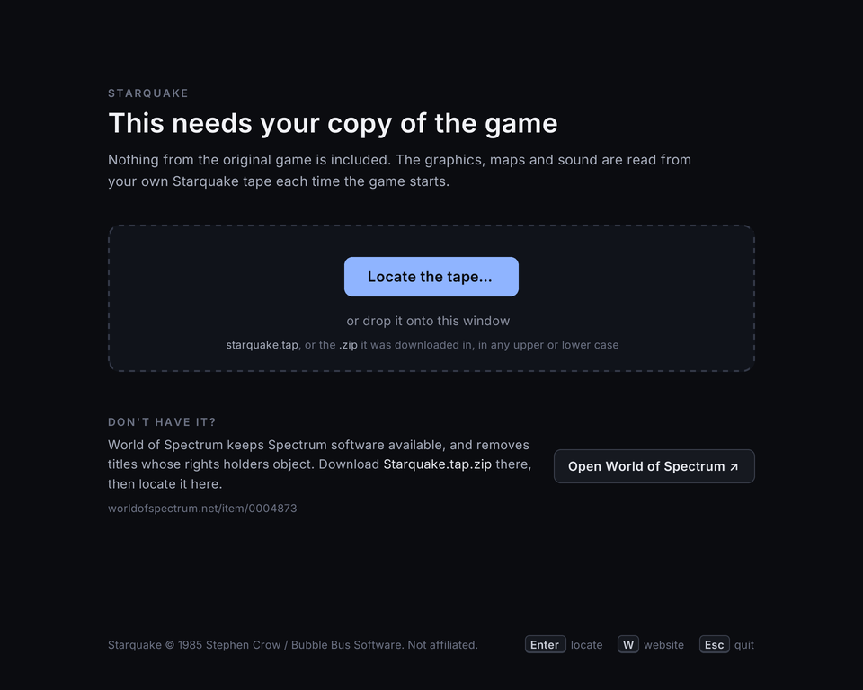
  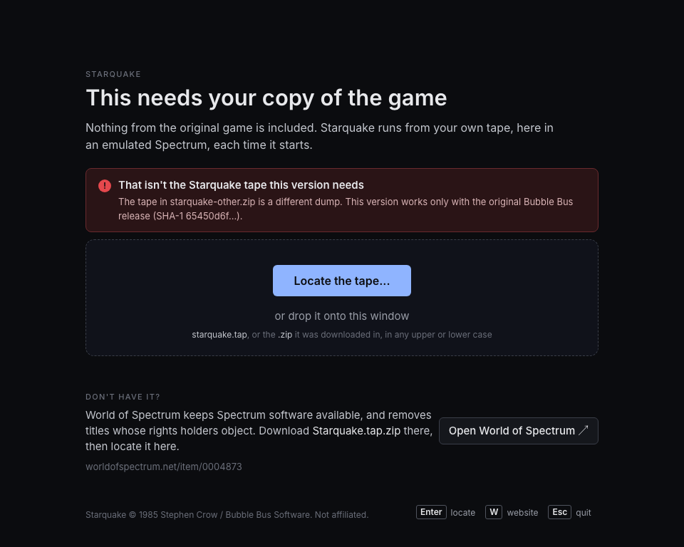

  The mockup's text says "the graphics, maps and sound are read from your own tape". The emulator's should say the game *runs* from the player's own tape.
- **The loading screen:** the picture the tape draws as it loads stays up until any key or button is pressed (or the picture clicked), when the definition asks for it (`[run] hold_loading_screen`): fast loading would otherwise show it for a moment. The machine stops the moment the tape's last block has gone in through the ROM's loader, before the loader or the game runs on, and the press doesn't reach it. Games that wait by themselves, as Starquake does, don't ask. Either way, a card at the picture's foot says "Press any key or button to go on.", in the title card's words and with no keys listed (How to play says what the keys do, once a game starts): the program knows a loader waits when it sits in the ROM's `PAUSE 0` with tape still to load (a timed `PAUSE` goes on by itself, so it carries no card). There, any button (the face buttons, the shoulders, the triggers, Start) and any key (letters and digits too) taps ENTER, which the ROM's `PAUSE` takes, rather than what it does in play: a Kempston joystick's fire is no key, and `PAUSE` waits for a key. The directions never go on: not the D-pad or the stick, nor the arrows. Esc and Select open the guidance menu as everywhere, and the program's F keys, the modifiers and a key pressed with Cmd or the Windows key don't go on either.
- **A frame's picture during blocking sound effects:** while an effect holds the game, the screen as it was when the effect started stays up. The emulator gets this right as long as it presents the screen at the moment each frame ends.

## 9. Controls

**Keyboard:** a second pad by default (`[run] keyboard = "pad"`), through the same `[pad]` mapping as a plugged-in one in each state, so games play in their joystick mode from the keyboard too: the **arrows** play as its D-pad (unless `[pad] arrows` gives them their own meaning), **Space** its west button, which fires by default, and **Enter** its Start; no other key plays (#194), and no Spectrum key reaches the game then. A state may have several `[pad]` tables, each applying while a value test holds (`when`), the first that holds winning, and a direction's ways may be set one by one: Starquake's pad moves BLOB left and right only while he's on foot, so a diagonal doesn't pick up or build, boards a hover platform with up where it waits, and flies it, while the keyboard's arrows keep up and down. A game that needs the Spectrum's own keyboard (typing, a define-keys screen, keys a pad can't stand in for) turns it on in its definition, throughout (`keyboard = "spectrum"`) or in some states (`keyboard_in`). While it's on, the Spectrum's keys reach the game as on the original: letters, digits, ENTER, SPACE, Shift as CAPS SHIFT, the left Ctrl and Alt (Option) as SYMBOL SHIFT, Backspace as DELETE, and the Spectrum's cursor keys typed its own way, CAPS SHIFT with 5 to 8; the keys the Spectrum doesn't have still play as a pad, the arrows its D-pad and the right Ctrl, the right Alt and `/` its fire (`/` for a Mac, where other apps may take the right Option tapped twice for a shortcut of their own), since Space is the Spectrum's then. A tape played plainly has the Spectrum's keyboard on, the arrows driving the Kempston joystick. For a game that has it off anywhere, the guidance menu's **Use the Spectrum keyboard** toggle, under CONTROLS and off by default, turns it on for the session (it isn't saved); the toggle isn't shown where the game has it on throughout: in plain play, or with `keyboard = "spectrum"` and no `keyboard_in`. It's the way past a define-keys screen or a password the definition doesn't know. When the game asks for text (a `[text_entry]` or `[name_entry]` state, §12) the joystick waits: the Spectrum's keyboard is on, every key typing straight into the game, and the pad drives the text-entry card. Which state the keyboard and the pad follow is the one the game was last seen in, so a title passed only every few frames still starts a game on Enter whichever frame it's pressed in. While the window has focus it grabs the keyboard, so keys the system would take for its own shortcuts reach the game where the system allows it; a Mac doesn't stop other apps watching keys for theirs. The program's own keys are others: **Esc** opens the guidance menu, **F5** saves, **F9** loads, **F11** toggles fullscreen. A definition may bind keys the Spectrum doesn't have to its `[[actions]]` (Starquake's **Tab** switches between routes).

**Gamepad** (any controller the operating system knows, by USB or Bluetooth, plugged in at any time):
- **Moving:** the D-pad and left stick move. By default, in play, the pad drives the joystick the definition names (`[run] joystick`: Kempston, Sinclair, cursor keys, or the game's own keys), whichever control method the game's menu chose if the game reads them all.
- **Buttons, by position, not by letter.** A definition maps the four face buttons (`west`, `south`, `east`, `north`), the shoulders, **Start** and **Select**, per state. By default the west button fires, Start pauses in play and starts a game from the title screen, and **Select opens the guidance menu**, always. A state can have every button and every key do one thing (`[pad.<state>] any`), the directions apart: Starquake's title starts a game on any key or button, since the program has chosen its controls for it, Esc, the F keys and Select still the program's, and its directions do nothing there.
- **Letters shown in hints follow what the pad reports itself as.** Microsoft's vendor ID gets Xbox letters, Nintendo's gets Nintendo letters (A on the right; A confirms), and Sony's gets the cross, circle, square and triangle. A pad reporting as an Xbox pad shows Xbox letters, whatever is printed on it.
- **Split meanings.** Some games give one direction two meanings, decided in their own code (in Starquake, *up* both picks up and boards the hover platform). A pad can separate them, but only through the game: the definition names the point where the game decides, and an `[[actions]]` entry applies a patch there for one frame, or a write that suppresses one meaning. If that proves fragile for a game, it ships without the split.
- **No accidental actions.** A press is told apart from a hold. A button still held when a menu closes, or when a game starts, is held back from the game until it's let go, so the press that closed the menu doesn't also pause, fire or jump. The pad never types into what the game reads as letters (high-score initials, codes) except through the text-entry card (§12).

## 10. The pause notice

When a definition names its game's paused state, the picture dims there and a card says how to go on: in the definition's own words for the keyboard (for Starquake, any move or fire continues once the pause key is let go), and A or B on a pad.

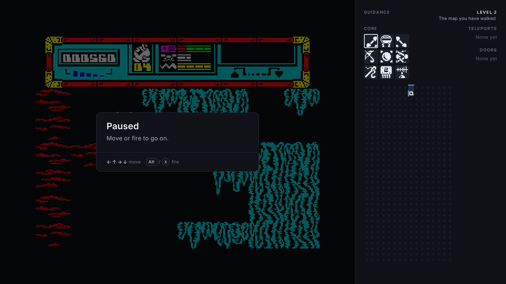

The title's state may carry a notice too: a card over the foot of the title, which isn't dimmed, saying how the game plays here where its own screen says otherwise. Starquake's title lists its control options, but the program chooses the joystick for the player there (`[[states]] set`), and any key or button starts a game there (`[pad.title] any`), so its card says to ignore the list and press any key or button to start, in the loading screen card's words and with no keys listed: How to play shows them once a game starts.

### 10.1 How to play

When a game starts, a definition's `[about]` shows as a card over the dimmed, paused game: the goal in a sentence or two, then the main moves, each with its key and, while a pad is plugged in, its button. Enter, Esc or the pad's confirm or back plays on. A "Show next time" toggle on the card (the arrows left and right, or a click) turns its showing at a game's start off, kept per game in its folder (`how-to-play.txt`). The menu's *How to play* row opens the same card any time, its button reading Back, which returns to the menu.

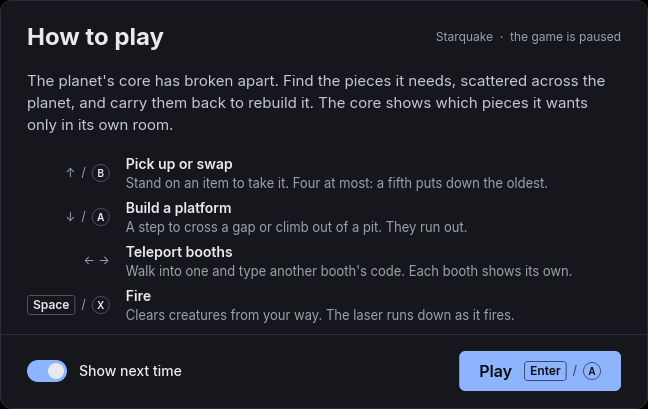

## 11. Guidance and training

### 11.1 The panel

Beside the picture, the panel offers optional help, drawn by the program and never by the game. Nothing in it changes what the game does. A definition defines **guidance levels** from 0 (the original, no help) upward, each adding to the ones below, with a name and a one-line description. It also defines the **widgets** each level adds:

| Widget | Shows |
|---|---|
| `text`, `counter`, `meter` | a value, a number, a bar |
| `chip-list` | short words in the game's own font, at a whole number of screen pixels per game pixel, so every letter is the same size (codes, names) |
| `icon-grid` | pictures in the game's own graphics, each bright, dim or outlined (items needed, delivered, carried) |
| `card-set` | groups of pictures, each dim until something answers it (a door's key cards) |
| `map-grid` | a grid of places: walls along each edge without an opening, so an opening is a gap; markers for the player, items and features; routes in two colours, and arrows at the picture's edge for the way out |

At level 0 the panel shows the Off level's description, which names what the menu holds (Starquake: "Guidance or training"), followed by the keys that open the menu, drawn by the program: Esc, and the pad's Select as its maker marks it (Back, Create, −) while a pad is plugged in. At every level, the training switches on are listed at the panel's top, by their labels.

A widget takes its data from a value, a table, or what the script returned. The game's font and graphics are always read from the player's tape at run time; definitions never carry them.

**Hints.** A definition may add **hints**: one short line each, in its own words, shown in the panel under the level's name while its condition holds (a value, a state, or something only the script can work out), on a band tinted with the accent so it reads at a glance and is as easy to ignore. One shows at a time, the most important first, and it goes when its condition stops holding, or after a few seconds for one whose condition lasts (Starquake's hands full); nothing dismisses it. Each hint has its own levels: what the player could work out themselves from level 1, what they couldn't have known from 4, and one a higher level makes needless can stop there. A game with hints keeps the line's slot from level 1 even while none holds, so the widgets don't move as hints come and go; level 0 shows none. `sidekick check` refuses a hint too wide for the line.

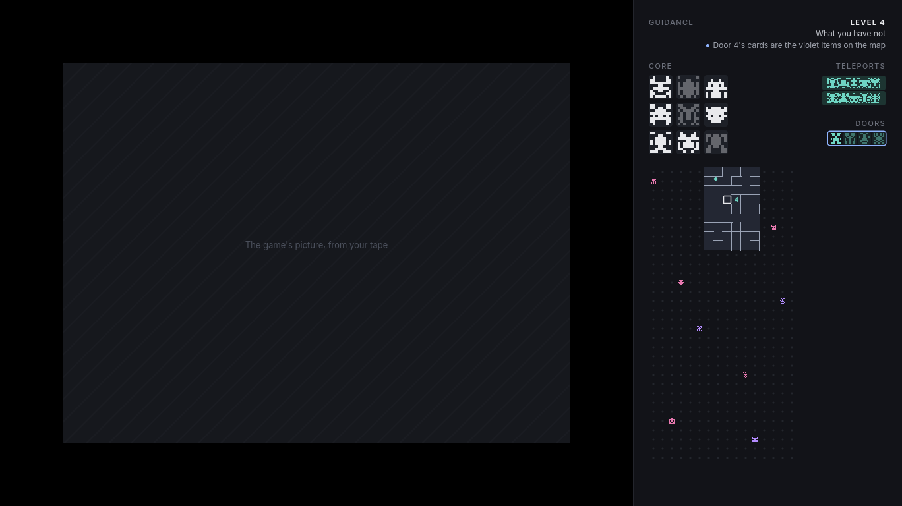

**Levels should be honest about what they tell.** As a convention: the lower levels show only what the player could have written down; the upper ones tell what they couldn't have known. The level's description says which.

Starquake's seven levels are the reference: [`docs/games/starquake.md`](docs/games/starquake.md).

| | |
|---|---|
| 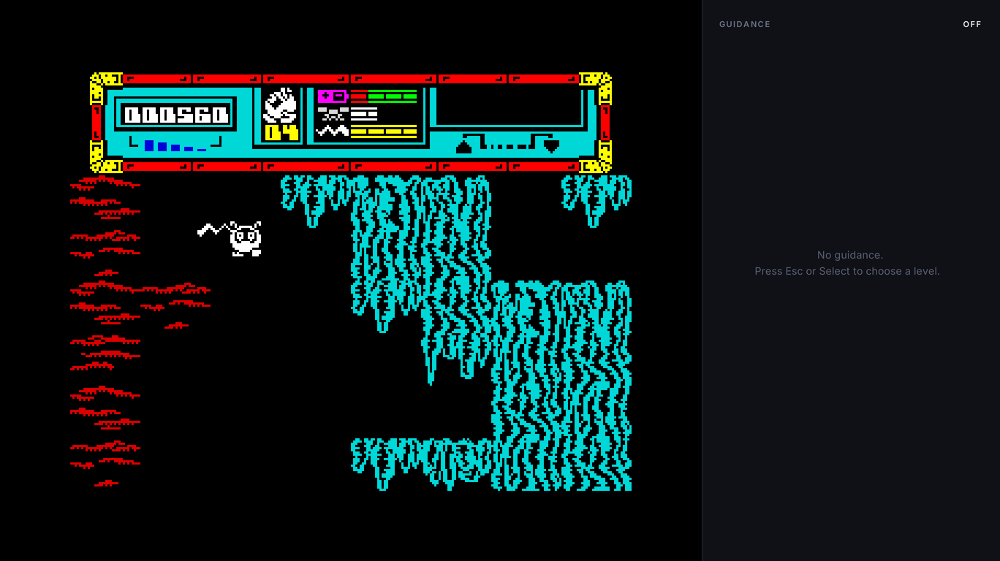 |  |
| 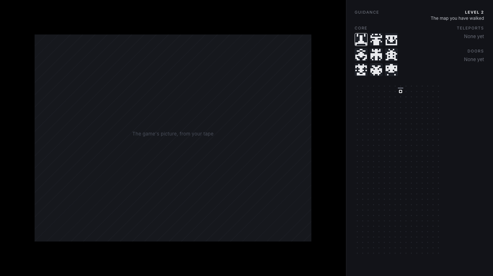 |  |
| 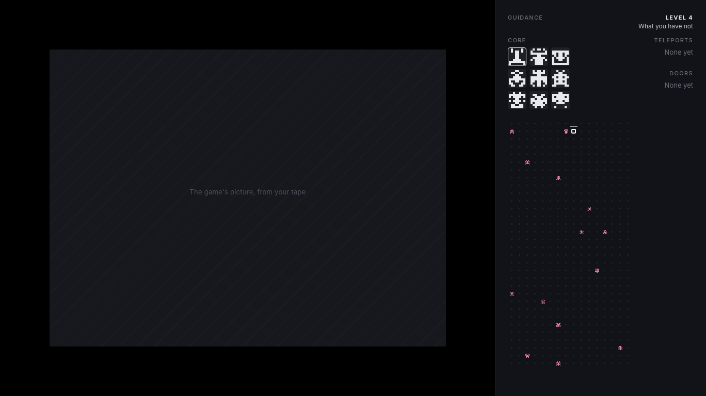 | 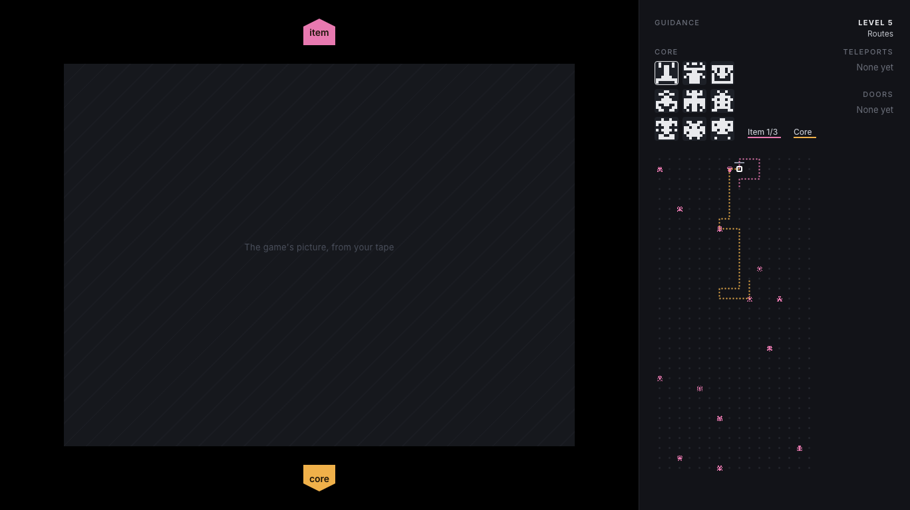 |
| 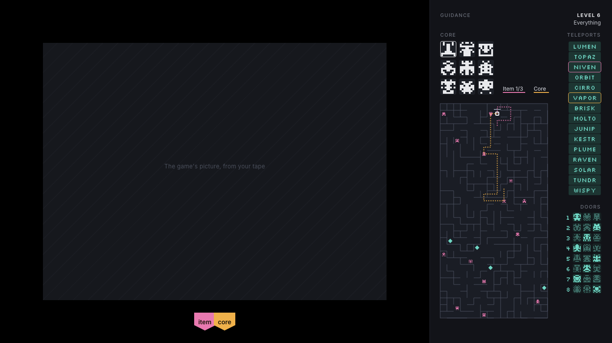 | |

### 11.2 The guidance menu

Esc, or Select on a pad, opens the menu and pauses the game. It's built from the definition.

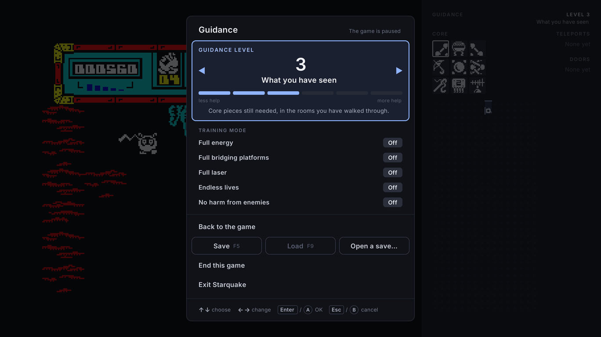

- **Guidance level:** left and right, or Enter on it to step up and wrap round. Changes take effect at once in the panel. Shown when the definition has levels.
- **Training mode:** one **On/Off** switch per `[[cheats]]` entry, with its label. Each is a write between frames, a value held from going down, or a patch applied while it's on.
- **Use these settings / Back to the game:** applies and returns. If applying would raise what the game's score will show (a higher level than this game has had, or a training switch it hasn't used), a question asks first: "Your score will show this."
- **Save, Load, Open a save…:** three buttons in one row (§13). Left and right move between them.
- **Forget the kept lists:** shown while a `[persist]` list holds something, with the definition's wording (Starquake: "Forget the teleport codes"); asks for a second press.
- **End this game:** shown in play when the definition says how (`[[actions]]` entry `end_game`, such as Starquake's A S D F G); asks for a second press.
- **Exit:** asks for a second press. "Exit Starquake" names the game.

  An action pressed once turns red and says "Press Enter or A again to …"; moving away cancels it.
- **Esc or B leaves** without applying: changes made in the menu are undone.
- **The record:** a game remembers the highest guidance level it used, and which training switches. After a game, that's shown beside the game-over and high-score screens (§13).

## 12. Typing a word with a pad

Some games ask for a word on the keyboard: a code, a password, a name. A definition's `[text_entry]` describes it: the state in which it's asked for, the letters allowed, the length, and where to show the card. On a pad, the first press there opens a card that leaves the game's own echo of the letters visible.

- **Choosing**, when a `[persist]` list holds candidates (and the guidance level allows it): the card opens on them. Up or left goes to the previous one, right or down to the next, round the ends. The title counts them ("2 of 4"), and the panel outlines the chosen one where it shows it.
- **Spelling:** the west button toggles to spelling, and back. Up and down step a slot's letter through the allowed letters, left and right move between slots, and B clears them.
- **A enters** the word either way. It's then typed on the keys the game reads, one letter down for a frame and released the next (timings from the definition), because games often wait for every key to be let go before reading the next letter.
- **While the card is open, the pad drives only the card.** The game sees none of it. Otherwise a held A could keep the game waiting for a release and swallow letters.
- **Keyboard players** never see the card.
- **A high score's name** gets the same card from `[name_entry]`, in the state where the game asks for it. It offers the names entered before first, the most recent first, from a list the program keeps itself: the name of each entry a game puts in the high-score table (§13). While spelling, A takes the letter into its place and moves on to the next, and enters the name at the last, so every place the game waits for gets a letter. A space, when the game takes one, is shown as an open box (␣).

| Choosing | Spelling |
|---|---|
| 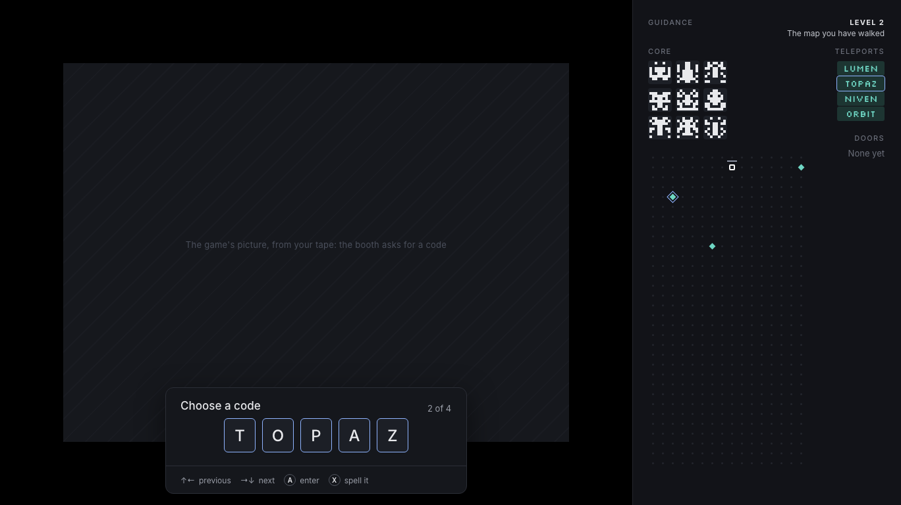 | 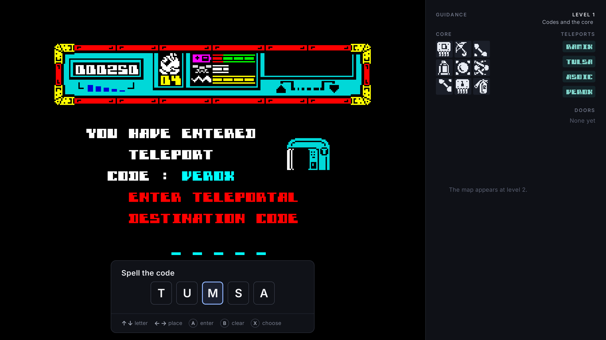 |

**Kept lists.** A definition's `[persist]` lists are kept between games in the game's data folder, as plain text (Starquake: every teleport code discovered, in `teleporter-codes.txt`). The panel and the card use them from the start of every later game.

## 13. Scores and saves

**The high-score table**, when a definition describes it (`[high_scores]`), is kept between runs in `high-scores.txt` in the game's data folder, put back into the game's memory when it starts, and read back from it after each game: at the title, or as soon as the game has a high score's name, so a save loaded before the title doesn't lose it. Each entry carries the highest guidance level its game had.
- **Only games played here are kept**, so the kept table starts empty. Until one is kept, the game shows its own entries; they stay in its memory and are never kept.
- **Put back whole and ranked:** each kept entry goes in with everything the game keeps beside its name and score, ranked by score among the game's own entries, which fill the rest. The table is as the last run left it.
- **A training game** is shown in the table, then left out of it.
- **A game a save was loaded into** stays in the table, marked "loaded".

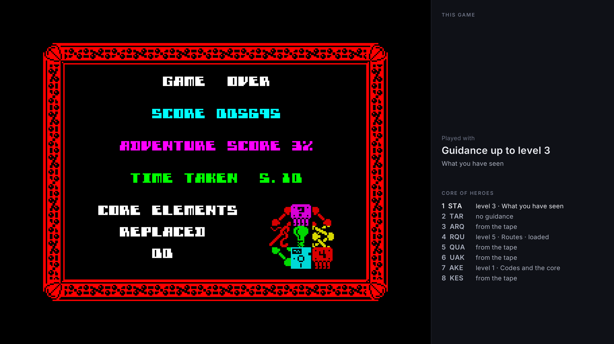

**Save games** work for every game, defined or not: a save is a zip of a snapshot of the whole machine, stored as a standard `machine.szx`, and the program's own state in `state.toml` (game id, the tape's SHA-1, guidance level, training switches, the game's record, and how far the game had got). Kept lists are saved to their own files as they change, so a save doesn't carry them.
- **F5** saves to a quick slot (`quick.sav` in the game's data folder, or in `tapes/<tape name>-<the start of its SHA-1>/` for a tape played plainly); **F9** goes back to the session's last save point, on the title screen too: the quick slot, or the save or crafted situation the session started from (`--load`) or opened, until an F5 saves a newer one. A situation is held as it was once set up, so F9 restarts a test; the file F9 goes back to is never written. The menu's row offers the same, plus **Open a save…** for any file, through the system's own dialog. On a Mac that dialog must run on the main thread. A plain `.szx` loads the machine alone; its switches are forgotten, and its game is marked loaded.
- A switch on in a save stays on when it's loaded, without being applied again: its patches are in the saved memory. A patch the switch has gained since the save was taken is applied, where the game's own bytes still are. A save of another game, or from another tape, is refused.
- A short notice confirms: "Game saved", "Game loaded", or why not.

  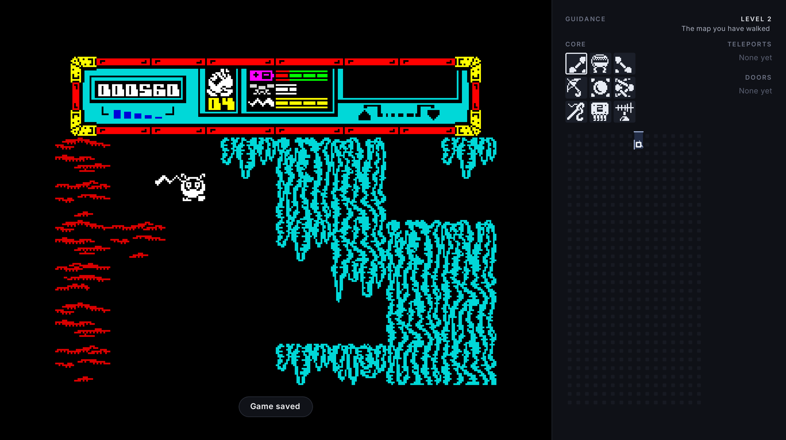
- **Saved on quitting:** closing the window during a game, or Exit in the menu, saves it to its own slot (`quit.sav`, beside the quick slot); at the title or game over nothing is kept. Going on from it is the same game, so it isn't marked loaded. So does **Cmd-Q** or Quit in the Mac menu, which never arrives as the window closing, only as the program shutting down; handle both. The next start offers it ("Continue where you left off?"): Enter or A continues, anything else starts afresh, and either way it's removed.

  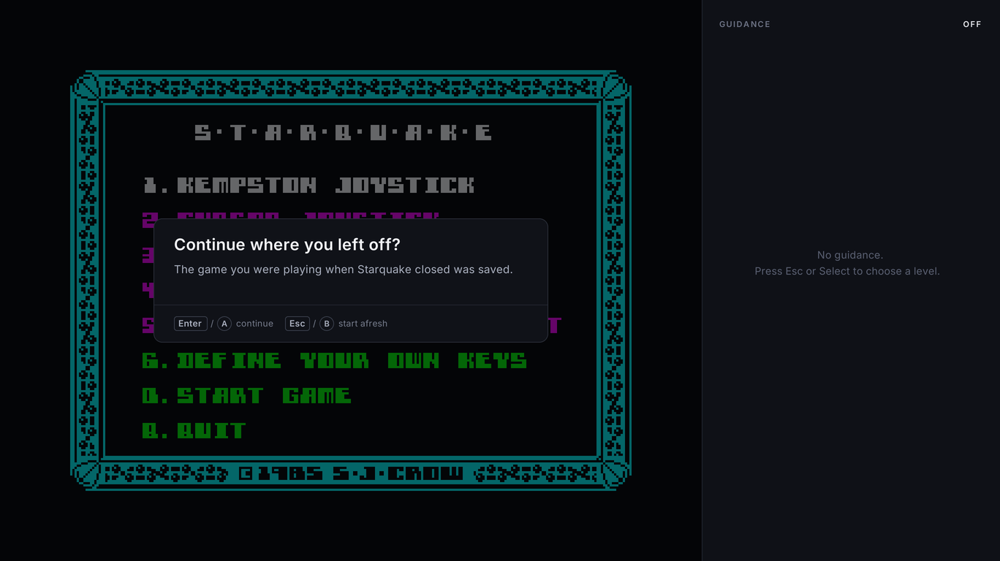
- **Wherever the game is** (paused, typing a code, the menu open), a snapshot can be taken. Take it at the sync point wherever possible, so loading resumes cleanly; otherwise at the end of a frame.
- **A loaded game is marked** beside its score.

**Crafted situations, for testing:** a short TOML file of `name = value` lines naming only what differs from a new game, using the definition's `[values]` names: the room, the player's position, lives, energy, items carried, codes seen, training switches. The program starts a new game, writes those into memory, then enters play through the routine the definition names (`[situations] enter`). Crafted files hold nothing of the original's, so they can be committed, in the definition's `tests/`, which the zip players get leaves out. `sidekick TAPE --load FILE` starts from a save or a crafted file, in a window or headless. `--paused` starts the window paused once the game is in play, or at the moment `--load` sets up: by the game's own pause where the definition names a paused state and Start reaches it, and with the menu otherwise. So a manual test waits until the tester is looking.

## 14. What the player sees for a game without a definition

The same window, menus, saves and pad, minus what needs facts: no panel, no training switches, no kept scores, no pause card, no text-entry card. The menu offers "Find a definition for this game", which opens the project's page of known definitions, and shows the tape's SHA-1 so one can be written for it.

## 15. Authoring tools

What makes "anyone can add a game" real:

- **`sidekick check DEF [TAPE]`:** checks a definition against the schema, lists what's still missing, that names it uses are defined, and, given a tape, whether it's one of the definition's dumps. Exits 0, 1 with problems, 2 when something can't be read. Checking each patch's expected bytes in the loaded game comes with `sidekick author`. Every finished definition in `games/` passes it in CI.
- **`sidekick convert FILE`:** TOML to JSON, or JSON to TOML.
- **`sidekick author TAPE [DEF]`:** runs the game with an overlay for authors:
  - every named value, live;
  - a **cheat finder**: narrow the whole memory down, frame by frame, to the bytes that went down, went up, changed, stayed or equal a number (lose a life, search "went down", repeat);
  - a program-counter sampler, which shows the addresses the game spends its frames at, to find the main loop's top and the states;
  - memory watchpoints, and breakpoints that pause the game;
  - **copy as TOML** for anything found.
- **`sidekick import-pok FILE.pok`:** turns a `.pok` file, the POKE format Fuse and ZXDB use, into `[[cheats]]` entries. Many games' endless lives and the like are already known, so this gives them training switches on day one.
- **Hot reload:** a definition edited while its game runs is reloaded at the next frame, with any error shown in the panel instead of the widgets.
- **The authors' guide**, `docs/definition-format.md`, walks through writing a definition from nothing: find the dump's SHA-1, add a cheat, map the pad, add a value and a widget.

## 16. Finding facts

The emulator needs no translation of any game, but everything a definition says is **facts**: addresses and what the bytes there mean. Find them with whatever is quickest and most accurate (disassembly of the player's copy, tracing, memory search, watchpoints), under the rules in `CLAUDE.md`. Write them down, in your own words, in `docs/re/<game>.md`. Disassemblies stay in `.scratch/`, are used only to understand the game, and are never committed or published.

1. **Trace:** run the game from the tape under scripted input, and record which code runs and in what order. Disassemble what runs, for reading locally.
2. **Diff memory:** compare snapshots before and after an action (pick up an item, enter a room, lose a life), or use the cheat finder.
3. **Watch:** set breakpoints and memory watchpoints on the candidates, to find the main loop's top, the routine that starts play in a room, the pause and death checks, keyboard reads, and the high-score table.
4. **Confirm:** mark each fact **confirmed** (seen running), **read** (understood from the disassembly) or **guess**. A definition's addresses should all be confirmed before it's shipped.

Never circumvent a protected loader to find facts; a protected game loads in the emulator as it would on a Spectrum.

## 17. How it's checked

The games' logic is the originals', so there's no rewrite to prove. What needs proving is the machine, the definitions, and everything read from or written to the machine.

- **The machine** against the outside references, in the fork's CI (§4).
- **Definitions:** every one in `games/` passes `sidekick check`; each round-trips TOML → structs → JSON → structs unchanged; the committed schema matches the structs.
- **The readouts:** from recorded play (input logs, or RZX recordings), assert that what the panel says matches what the game shows: the score, lives and room, the codes it displays, the items picked up.
- **Snapshots:** save, load into a fresh machine, and check the memory and registers are identical and the next 1,000 frames run the same.
- **Crafted situations:** each committed file starts its game, plays scripted input, and must reach its expected event.
- **The panel's look:** each widget, and each Starquake level, rendered headless into PNGs and compared with committed golden images. The panel is the program's own drawing, so its images may be committed; the game's picture behind it is a plain stand-in, and widgets that draw the game's graphics use stand-in graphics in tests.
- **Scripts:** the sandbox holds (no file access, the operation limit stops a runaway loop), and a script over its limit turns off its widgets rather than stalling.
- **Soak:** long runs of random input, looking for crashes, stuck states and readouts that stop making sense.
- **Writes and patches:** for each training switch and split pad meaning, a test that it does what it says and nothing else, for example that endless lives keeps the count and changes nothing else in the frame.

`scripts/check.sh` runs all of it, gates on its exit code, and names whatever it skipped for want of a tape in `assets/`.

## 18. Performance and platforms

- **Desktop** (macOS on Apple silicon and Intel, Windows, Linux): an accuracy-first Spectrum emulator runs a game 50 times or more faster than real time on a current desktop. At real speed that's a few percent of one core. Drawing the scaled picture costs more than emulating. Measure the script's share per frame; Starquake's routes are the heaviest expected.
- **Small handhelds** (for example a Miyoo Mini: Cortex-A7 at about 1.2 GHz, no 3D GPU, 640×480): measure early. An accuracy-first emulator may need a large share of one core there, and the window needs SDL's framebuffer path (SDL3's KMSDRM, or SDL2 where the firmware ships only that). The panel won't fit 640×480 beside the picture and would become an overlay.
- **A libretro core** is worth considering once the desktop program works. RetroArch then provides the screen, sound, input and save states on most handhelds and consoles, and Rust produces such a core naturally. Definitions would travel with it unchanged.

### Releases

Releases are built for **macOS** (one universal binary, Apple silicon and Intel, macOS 11 and later), **Windows** (x64, with no console window and the C runtime linked in) and **Linux** (x64, built on Ubuntu 22.04 so it runs from glibc 2.35), unsigned: the player's guide says how to open the program the first time on macOS and past SmartScreen on Windows.

- **Each platform's archive** (`scripts/package.sh`): the program, `games/` without any definition's `tests/`, `PLAYER-GUIDE.md` (`docs/player-guide.md`), `AUTHORS-GUIDE.md` (`docs/definition-format.md`), the README, the licence, `THIRD-PARTY.md`, and `licenses/` with Inter's and RustZX's licences and `THIRD-PARTY-NOTICES.txt`, the notices of every crate built into the program and of SDL3 (`scripts/notices.sh`, with cargo-about). It refuses a tape, snapshot or ROM file. **Each definition** in `games/` also goes on the release alone, as `<id>.zip` without its `tests/`, for a program already installed.
- **Making one:** the workspace version in `Cargo.toml` is the release's number. Push the tag `v<version>` on a commit of `main`, and `.github/workflows/release.yml` checks the tag matches the version, tests and builds on each platform, packs the archives and the definitions, writes the notes (`scripts/release-notes.sh`: the titles merged since the previous tag, the downloads and the notice), and creates a **draft** release. The maintainer reads the draft, edits the notes if need be, and publishes it. Nothing is published by the workflow. `scripts/release-notes.sh v<version>` previews the notes before the tag is made.

## 19. Build order

Each step ends green, committed, and on a reviewed pull request.

1. **The workspace:** this repository, the pinned fork dependency, the repo guard and CI, the ROM smoke test. *(Done.)*
2. **Fork patches** (§4), each a pull request on the fork, the `rev` bumped here after each: the frame loop on `run_until` with a sync address, public writes, registers and banks, `Clone`, SZX saving, the 320×256 picture, sound through blocking effects.
3. **Definitions:** `sidekick-def`, the schema, `sidekick check`; matching tapes by SHA-1; plain play.
4. **The window:** integer scaling, fullscreen and F11, title bar, sound, headless mode with screenshots; the tape prompt from `[[media]]`; the library.
5. **Controls:** keyboard, then the pad (joystick mapping, per-state `[pad]`, Start and Select, maker letters, hold-back).
6. **States, values and the authoring tools:** `sidekick author`, the cheat finder, `import-pok`, hot reload.
7. **Training switches**, the guidance menu, the record, the pause notice.
8. **The panel's widgets** and the **Rhai** runtime, each widget with its render test.
9. **Starquake:** its facts (§16), `games/starquake/`, levels 1 to 6 in order, each with its render test.
10. **The text-entry card** and kept lists.
11. **Kept high scores** with levels and marks.
12. **Saves:** quick slot, Open, saved on quitting, the offer, the loaded mark, crafted situations and `--load`.
13. **Split pad meanings**, if they hold up.
14. **The 128K and the AY** in definitions, and a second, simpler reference definition.
15. **Releases:** archives for each platform, with the player's guide, the authors' guide, `THIRD-PARTY.md` and the licences; each definition zipped without its `tests/`. `scripts/package.sh` packs a platform's archive and refuses a tape, snapshot or ROM file; CI's build jobs keep its archive as their artifact. A `v*` tag builds all three, macOS as one universal binary, into a draft release with notes from the merged titles (§18, "Releases").

## Mockups

All the files in `docs/mockups/starquake/`, at the window's size of 1368×768. They show Starquake, but the layout, wording and behaviour are the same for every game:

| File | Shows |
|---|---|
| `tape-prompt.png`, `tape-prompt-wrong-dump.png` | The tape prompt, and its refusal of a different dump |
| `play-level0.png` … `play-level6.png` | A game in play at each of Starquake's guidance levels |
| `menu.png` | The guidance menu over the game |
| `paused.png` | The pause notice |
| `booth-choose.png`, `booth-spell.png` | Typing a word with a pad: choosing, and spelling |
| `saved-note.png` | The notice after F5 |
| `offer.png` | The offer to continue the game saved on quitting |
| `game-over.png` | The record and the kept high-score table beside the game over |

The hint line is drawn in `docs/mockups/2026-10-14-hint-*.png`: at level 1, at level 4, with the slot empty, and with the longest of Starquake's hints.

Still to be drawn: the library screen, and the menu for a game without a definition (§14).

They're recreations of the earlier implementation's screenshots, with stand-ins for everything of the game's: its picture, its item pictures (generic pixel icons), its font (a stand-in pixel font), its teleport codes and high-score initials (made-up ones). `mockups.html` draws them; `scripts/render-mockups.sh` renders it to these PNGs.
